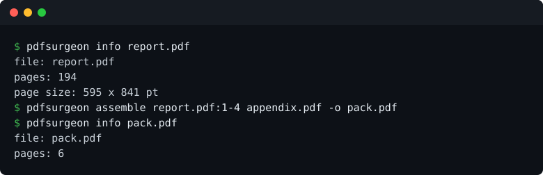

# pdfsurgeon

Take pages out of a PDF, put PDFs together, or split one into many, without breaking it. One binary, no Ghostscript.



```
cargo install pdfsurgeon
```

## What it does

```
pdfsurgeon info <file>
pdfsurgeon select <file> --pages <spec> -o <out.pdf>
pdfsurgeon split <file> [--out <dir>]
pdfsurgeon merge -o <out.pdf> <in1.pdf> <in2.pdf> ...
pdfsurgeon assemble -o <out.pdf> <file[:pages]> ...
pdfsurgeon rotate <file> --pages <spec> --angle <deg> -o <out.pdf>
```

A page spec is a page, a range or a list: `1`, `1-4`, `1,3-5,9`. `--password` opens an encrypted file.

The hard part of editing a PDF is what you cannot see: bookmarks, destinations, form fields and attachments all point at pages. Delete a page and those pointers stay aimed at nothing. pdfsurgeon rebuilds those lists as it goes, which is why `qpdf --check` reports no warning on its output.

Exit codes: 0 it worked, 1 it did not, including a command line it could not read.

## Measured

| | |
|---|---|
| Split a 970 page, 13 MB document | 1.02 s, against 3.71 s for qpdf 12.3.2 |
| Merge 1,940 pages | 0.75 s, against 5.36 s |
| Where it loses | mutool selects three pages quicker, because it never builds an object model |

Method, full table and that reason: [BENCHMARKS.md](BENCHMARKS.md).

## What it will not do

- **Damaged files.** Refused. Guessing at a broken structure produces a file that opens and is wrong.
- **Encryption on the way out.** `--password` opens an encrypted file, and it comes out unencrypted.
- **Recompression or font work.** Pages are copied as they are.
- **Signatures and form scripts.** Dropped, because a changed document cannot honestly carry a signature over its old contents.
- **Tagged PDF, layers, attachments.** Tags and layers flatten; an attachment is only carried when every page is kept.

## From Rust

Every command is a public function, every error is one `Error` enum, and `lopdf::Document` is re-exported so a caller cannot end up on a different version of it.

```rust
use pdfsurgeon::{Document, PageSpec};

let doc = Document::load("report.pdf")?;
let keep = PageSpec::parse("1-3,7", doc.get_pages().len() as u32)?;
pdfsurgeon::select(&doc, keep.pages())?.save("extract.pdf")?;
```

## Licence

Apache-2.0. Free to use, and there is no plan to charge for it.
